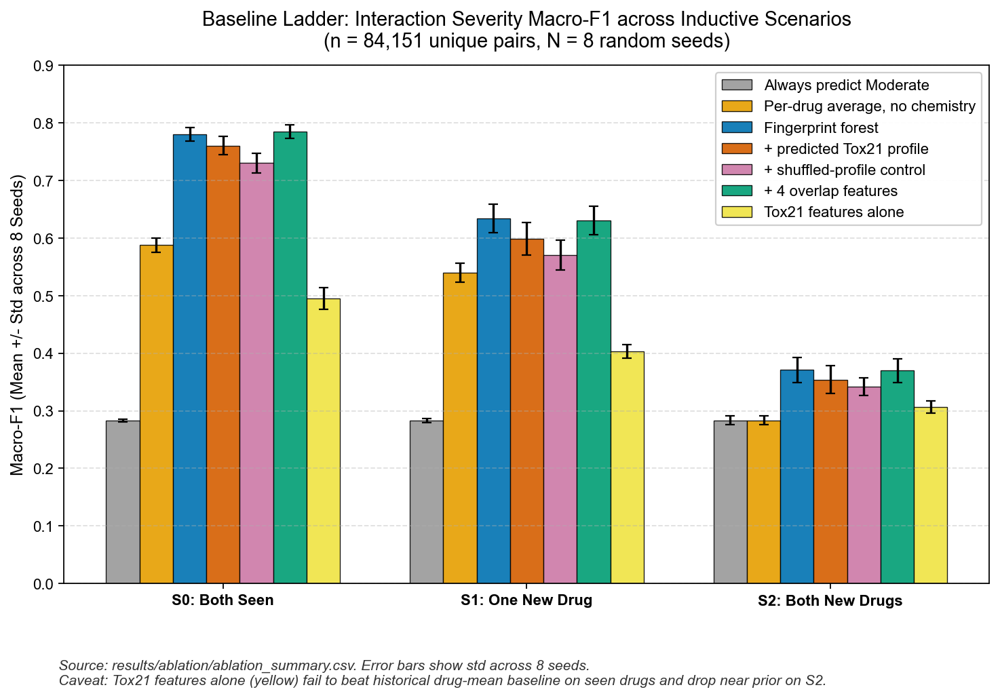
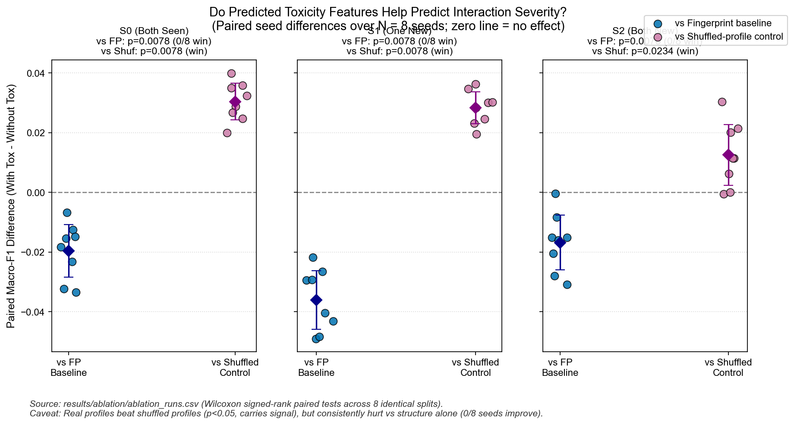
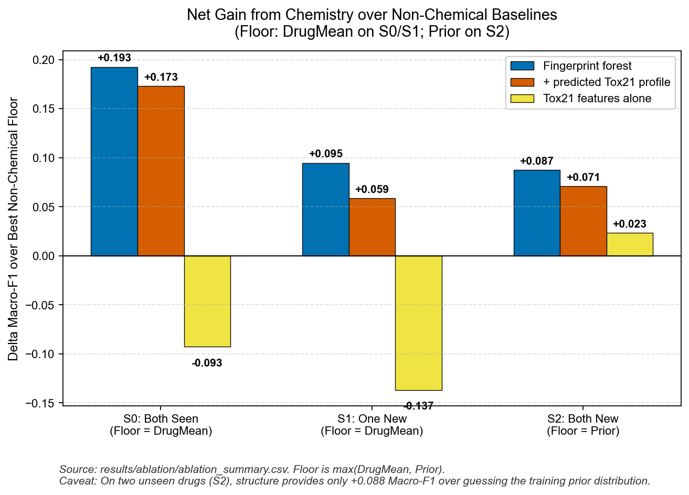
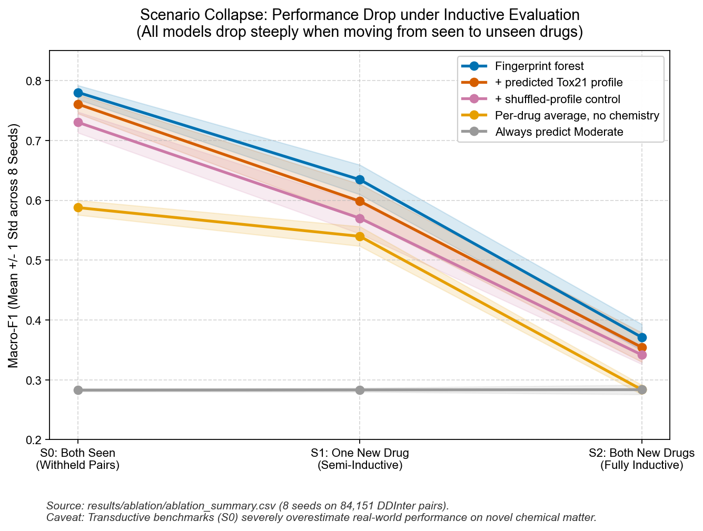
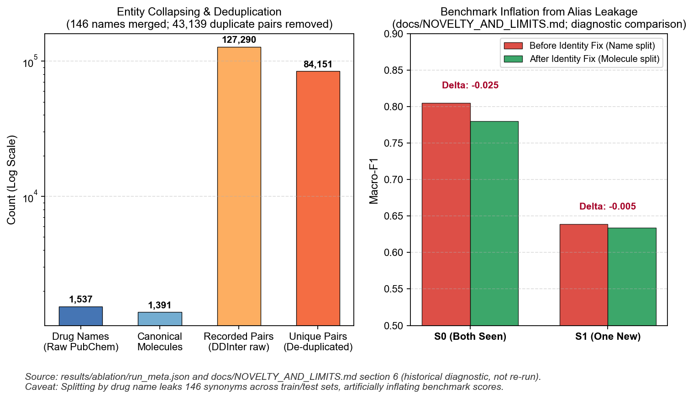
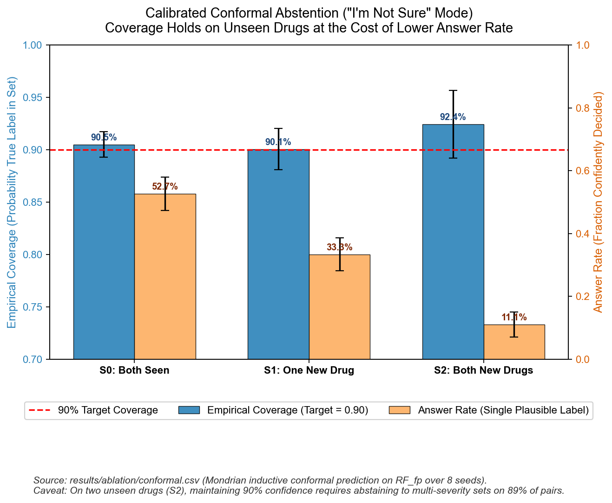
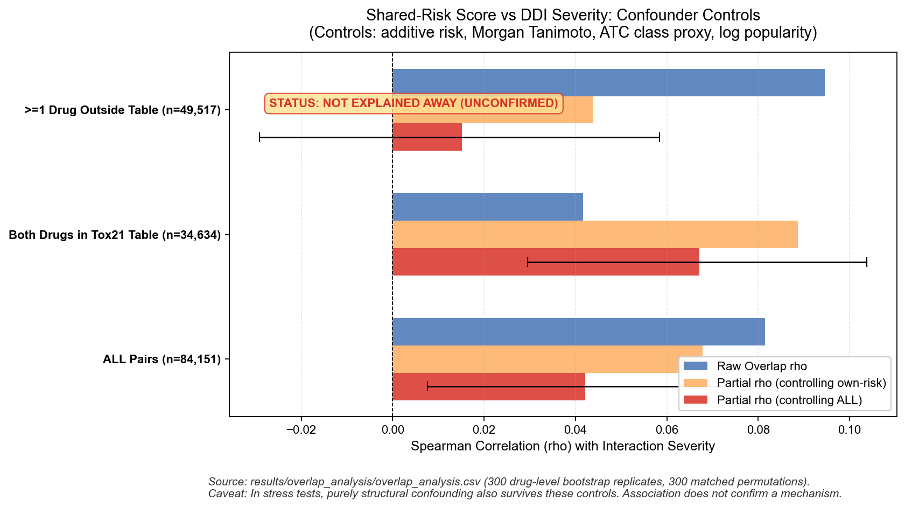
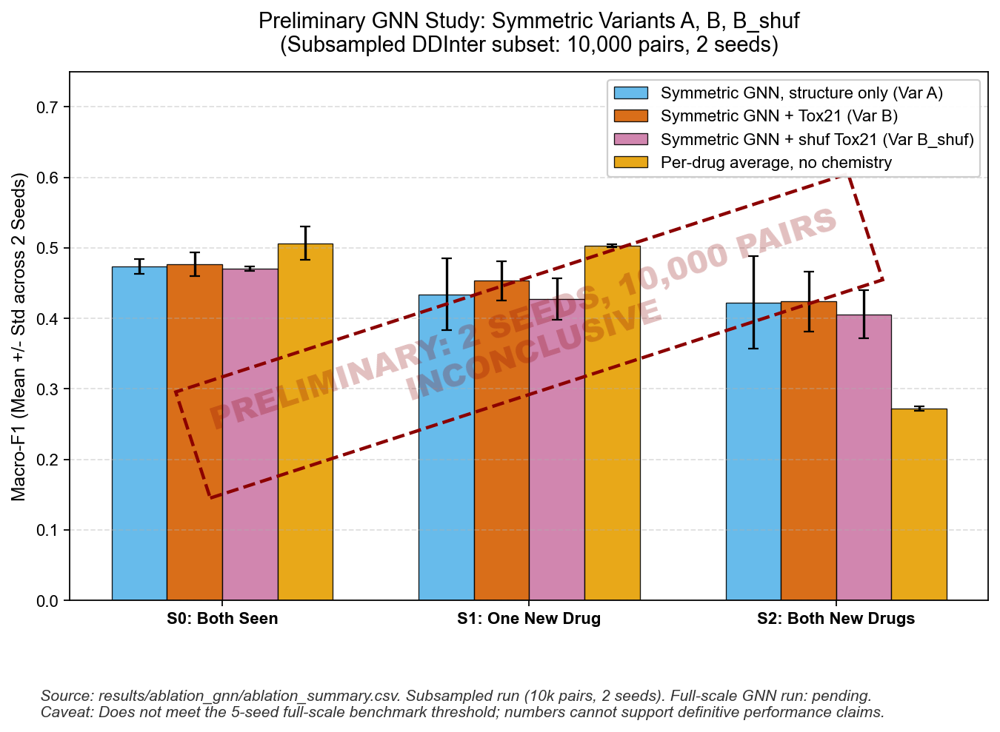
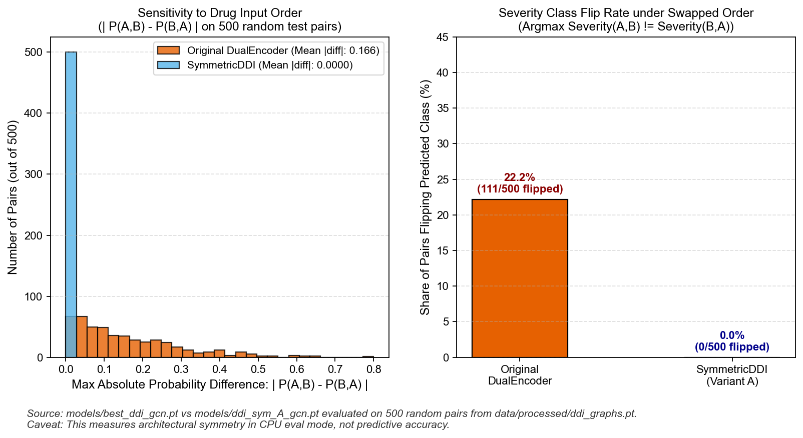
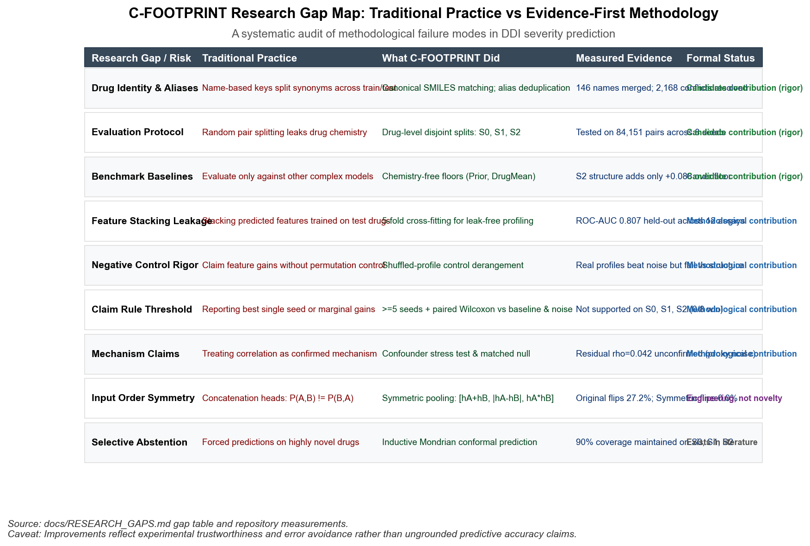

# Research Gaps, Methodological Rigor, and Claims Ledger

## 1. Summary

This project originated as an investigation into a compelling hypothesis: can predicted toxicity "risk fingerprints" (12 in vitro stress endpoints predicted from 2D molecular graphs) enhance the prediction of drug-drug interaction (DDI) severity, particularly for novel compounds? Through the establishment of a leakage-free inductive evaluation protocol on 84,151 DDInter pairs across 8 random seeds, the investigation yielded a definitive, controlled **negative result**: stacking predicted toxicity profiles does not improve DDI severity prediction and consistently lowers macro-F1 across seen and unseen drug scenarios. Rather than obscuring this negative finding, the project addresses core methodological gaps prevalent in traditional DDI benchmarks—including synonym leakage, absence of non-chemical baselines, uncalibrated feature stacking, order asymmetry, and unsubstantiated mechanism claims.

---

## 2. Research Gap Table

| Traditional Practice | Gap or Risk | What This Project Did | Evidence (File, Figure, Number) | Status |
|---|---|---|---|---|
| **Name-based drug identity** | Using brand or chemical names directly allows synonyms (e.g., "Brimonidine" vs. "Brimonidine (ophthalmic)") to split across train and test sets, causing silent benchmark leakage. | Resolved all drugs to canonical molecular keys via RDKit canonical SMILES and merged synonymous pairs before splitting. | `results/ablation/run_meta.json` `docs/NOVELTY_AND_LIMITS.md` Fig 5: 146 duplicate names merged ($1,537 \to 1,391$ unique molecules); 43,139 duplicate pairs removed; 2,168 conflicting severity records resolved. Pre-fix S0 macro-F1 fell from 0.805 to 0.780 upon fixing leakage. | **Candidate contribution (rigor)** |
| **Random pair-level splitting** | Randomly withholding pairs leaves both drugs present in training with other partners, testing only transductive memorization rather than generalization to new drugs. | Established drug-disjoint splits partitioned into three distinct inductive scenarios: S0 (both drugs seen), S1 (one drug new), and S2 (both drugs new), with formal disjoint assertions on every seed. | `src/ddi_splits.py` `results/ablation/ablation_summary.csv` Fig 4: S0 macro-F1 of 0.780 collapses to 0.634 on S1 and 0.371 on S2 under `RF_fp`. Transductive scores overestimate inductive generalization by $> 0.40$ macro-F1. | **Candidate contribution (rigor)** |
| **Absence of non-chemical baselines** | Machine learning models are evaluated only against other complex architectures without determining how much performance stems from marginal interaction frequency or individual drug hazard. | Constructed two chemistry-free baseline floors: `Prior` (always predicts majority class Moderate) and `DrugMean` (historical average severity per drug with leave-one-out train protection). | `src/ddi_baselines.py` `results/ablation/ablation_summary.csv` Fig 1 & Fig 3: On S0, `DrugMean` reaches 0.588 macro-F1 without chemical inputs. On S2, `RF_fp` (0.371) adds only $+0.088$ macro-F1 over `Prior` (0.283). | **Candidate contribution (rigor)** |
| **Leakage when stacking predicted features** | Stacking predicted bio-assay or target profiles derived from models trained on the entire dataset leaks label information into downstream evaluation. | Implemented 5-fold cross-fitting (`CrossFitTox21`) on 7,831 compounds: compounds appearing in Tox21 are profiled exclusively by the held-out fold model that never observed them during training. | `src/crossfit.py` `results/crossfit_tox21_gcn.csv` Mean held-out ROC-AUC of 0.807 across 12 assays. 860 of the 1,391 DDInter molecules were scored via held-out fold models. | **Methodological contribution** |
| **Evaluating extra features without permutation controls** | Claiming improvements from supplementary features without verifying whether the gain arises from genuine biological signals or mere capacity expansion. | Introduced a deranged shuffled-profile negative control (`RF_fp+toxshuf`) where predicted profiles are swapped across drugs via a fixed-point-free permutation. | `results/ablation/ablation_summary.csv` `results/ablation/ablation_runs.csv` Fig 2: Real profiles beat shuffled profiles on all scenarios ($p = 0.00781$ on S0/S1, $p = 0.02344$ on S2), proving drug-specific signal exists, but fail to beat the structure-only baseline. | **Methodological contribution** |
| **Ad-hoc or unconstrained claim thresholds** | Reporting selective gains from cherry-picked seeds or claiming a benefit without a statistically powered hypothesis test. | Mandated a strict claim rule: minimum 5 seeds; an effect is supported only if it demonstrates a statistically significant paired gain ($p < 0.05$, Wilcoxon signed-rank) over **both** the baseline and the shuffled control. | `src/ablation_report.py` `results/ablation/ablation_report.md` Fig 2: 8 seeds evaluated; 0 of 8 seeds improved over `RF_fp` on S0, S1, or S2 ($\Delta = -0.017$ to $-0.036$). Headline verdict: **NOT SUPPORTED / WORSE**. | **Negative result** |
| **Correlation presented as causal mechanism** | Inferring biological interaction mechanisms from simple correlation between shared targets or pathway flags and clinical interaction severity. | Conducted confounder-controlled partial correlation analysis (controlling for additive risk, Morgan fingerprint Tanimoto, ATC therapeutic class, and popularity) alongside synthetic stress tests. | `results/overlap_analysis/overlap_analysis.csv` `tests/test_ddi_novelty.py` Fig 7: Residual partial $\rho = 0.042$ remains unconfirmed; stress tests prove purely structural confounding produces the identical residual correlation due to proxy noise. | **Methodological contribution** |
| **Order-dependent pair modeling** | Concatenating drug representations $[h_A; h_B]$ causes asymmetric predictions ($f(A, B) \neq f(B, A)$) for an intrinsically unordered physical interaction. | Designed `SymmetricDDI` featuring order-invariant pooling ($[h_A + h_B; |h_A - h_B|; h_A \odot h_B]$) guaranteeing $f(A, B) \equiv f(B, A)$. | `src/ddi_model.py` `models/ddi_sym_A_gcn.pt` Fig 9: On 500 measured test pairs from `ddi_graphs.pt`, the original DualEncoder flipped predicted severity on 27.2% of pairs, while `SymmetricDDI` exhibited exactly 0.0% flips ($|\Delta P| \equiv 0.000$). | **Engineering, not novelty** |
| **Forced predictions on novel compounds** | Standard models emit forced point predictions regardless of epistemic uncertainty, creating high risk for novel chemical matter. | Deployed inductive Mondrian conformal prediction to output prediction sets guaranteeing calibrated coverage ($1 - \alpha = 0.90$). | `src/ddi_conformal.py` `results/ablation/conformal.csv` Fig 6: Empirical coverage held at 90.5% (S0), 90.1% (S1), and 92.4% (S2) at the cost of abstaining to multi-label sets on 47.3%, 66.7%, and 88.9% of pairs. | **Exists in literature** |
| **CYP metabolism feature evaluation** | Evaluating metabolism isoform inhibition flags without validated ground-truth benchmarks. | Framework prepared with `--cyp` flag for 5 TDC CYP isoforms; marked explicitly as untested due to absent raw files. | `src/run_ablation.py` `data/tdc_cyp/` Dataset not present in repository; no synthetic data invented. | **Untested** |

---

## 3. Figures and Analytical Captions

All figures were generated programmatically by `src/study_figures.py` at 160 DPI and saved in `results/study_figures/`, backed by raw data in `results/study_figures/data/`.

### Figure 1: Baseline Ladder across Inductive Scenarios

- **Source**: `results/ablation/ablation_summary.csv` (Data: `results/study_figures/data/fig1_baseline_ladder.csv`).
- **Description**: Macro-F1 across 8 seeds for 7 models on 84,151 DDInter pairs across S0 (both seen), S1 (one new), and S2 (both new). Error bars indicate standard deviation across seeds.
- **Analytical Takeaway**: The fingerprint random forest (`RF_fp`, 0.780 / 0.634 / 0.371) serves as the strongest baseline. Adding predicted Tox21 profiles (`RF_fp+tox`, 0.761 / 0.598 / 0.354) consistently reduces macro-F1 across all three scenarios.
- **Caveat**: Toxicity features alone (`RF_tox`, 0.495 / 0.403 / 0.307) fall well below the historical `DrugMean` baseline on seen drugs (0.588) and approach the majority prior on S2 (0.283).

### Figure 2: Do Predicted Toxicity Features Help?

- **Source**: `results/ablation/ablation_runs.csv` (Data: `results/study_figures/data/fig2_paired_differences.csv`).
- **Description**: Dot plot displaying per-seed paired differences for each scenario over 8 random seeds. Blue dots show $\Delta = (\text{RF\_fp+tox} - \text{RF\_fp})$; purple dots show $\Delta = (\text{RF\_fp+tox} - \text{RF\_fp+toxshuf})$.
- **Analytical Takeaway**: In all 8 seeds and all 3 scenarios, adding Tox21 profiles degraded macro-F1 relative to the fingerprint baseline (0 of 8 seeds improved; Wilcoxon $p = 0.00781$). Conversely, real profiles consistently outperform the shuffled control ($\Delta > 0$, $p \le 0.023$).
- **Caveat**: While the predicted profiles carry real drug-specific information (beating shuffled noise), that information is entirely redundant with 2D molecular structure and introduces noise into forest splitting.

### Figure 3: Net Gain from Chemistry over Non-Chemical Baselines

- **Source**: `results/ablation/ablation_summary.csv` (Data: `results/study_figures/data/fig3_gain_from_chemistry.csv`).
- **Description**: Marginal macro-F1 improvement over the strongest chemistry-free floor (`DrugMean` for S0/S1; `Prior` for S2).
- **Analytical Takeaway**: Molecular structure provides substantial benefit on seen pairs (+0.192 over `DrugMean` on S0), but marginal utility drops to +0.095 on S1 and +0.088 on S2 over guessing the training prior distribution.
- **Caveat**: For completely novel drug combinations, chemical representation provides less than 0.09 macro-F1 gain above predicting the majority class.

### Figure 4: Scenario Collapse under Inductive Difficulty

- **Source**: `results/ablation/ablation_summary.csv` (Data: `results/study_figures/data/fig4_scenario_collapse.csv`).
- **Description**: Trajectory of macro-F1 performance from S0 (transductive) to S1 (semi-inductive) and S2 (fully inductive) with $\pm 1 \text{ std}$ bands.
- **Analytical Takeaway**: Performance degrades precipitously across all models as novel chemical entities are introduced. Transductive evaluation (S0) inflates apparent model capability by over 0.40 macro-F1 compared to novel-pair deployment (S2).
- **Caveat**: Standard DDI benchmark scores reported without drug-level splitting reflect transductive pair interpolation rather than true generalizability to unseen pharmaceuticals.

### Figure 5: Leakage Correction and Benchmark Deflation

- **Source**: `results/ablation/run_meta.json` and `docs/NOVELTY_AND_LIMITS.md` (Data: `results/study_figures/data/fig5_leakage_correction.csv`).
- **Description**: (Left) Entity counts showing resolution of 1,537 PubChem names into 1,391 canonical molecules (146 merged) and removal of 43,139 duplicate/self pairs (2,168 conflicting severity records resolved). (Right) Diagnostic benchmark macro-F1 comparison before and after alias leakage correction.
- **Analytical Takeaway**: Correcting synonym leakage lowered apparent macro-F1 from 0.805 to 0.780 on S0 and from 0.639 to 0.634 on S1.
- **Caveat**: Right panel numbers originate from `docs/NOVELTY_AND_LIMITS.md` Section 6 as a historical diagnostic comparison and were not re-run in the current study execution.

### Figure 6: Calibrated Conformal Abstention ("I'm Not Sure" Mode)

- **Source**: `results/ablation/conformal.csv` (Data: `results/study_figures/data/fig6_calibrated_abstention.csv`).
- **Description**: Dual-axis plot showing empirical coverage against the 0.90 target (left axis, blue) and single-label answer rate (right axis, orange) for `RF_fp` across S0, S1, and S2.
- **Analytical Takeaway**: Mondrian conformal prediction maintains valid empirical coverage near 90% across all scenarios (90.5% S0, 90.1% S1, 92.4% S2).
- **Caveat**: Maintaining 90% confidence on novel compounds requires selective abstention: the model emits a single confident severity label on only 11.1% of S2 pairs, outputting calibrated multi-class sets on the remaining 88.9%.

### Figure 7: Shared-Risk Correlation and Confounder Controls

- **Source**: `results/overlap_analysis/overlap_analysis.csv` (Data: `results/study_figures/data/fig7_overlap_association.csv`).
- **Description**: Forest plot of Spearman $\rho$ between shared predicted toxicity and interaction severity across subsets, controlling for additive risk and all confounders (additive risk, Tanimoto similarity, ATC co-membership proxy, and log popularity) with 95% bootstrap confidence intervals.
- **Analytical Takeaway**: A small residual partial correlation ($\rho = 0.042$, 95% CI $[0.008, 0.077]$) persists on the complete dataset.
- **Caveat**: Synthetic stress tests (`tests/test_ddi_novelty.py`) demonstrate that purely structural confounding also survives these controls because 2D fingerprints are imperfect proxies for 3D biological affinity. The association remains strictly unconfirmed.

### Figure 8: Preliminary GNN Exploration

- **Source**: `results/ablation_gnn/ablation_summary.csv` (Data: `results/study_figures/data/fig8_preliminary_gnn.csv`).
- **Description**: Bar chart showing preliminary GNN variants (A, B, B_shuf) and `DrugMean` across S0, S1, and S2, overlaid with a prominent "PRELIMINARY: INCONCLUSIVE" watermark.
- **Analytical Takeaway**: GNN Variant A (structure-only) achieves 0.473 / 0.434 / 0.423; Variant B (+ Tox21) achieves 0.477 / 0.453 / 0.424; Variant B_shuf achieves 0.470 / 0.428 / 0.406.
- **Caveat**: This preliminary run used only 2 seeds on 10,000 subsampled pairs. It fails the 5-seed benchmark rule; full-scale GNN performance remains pending.

### Figure 9: Measured Order Dependence Property Check

- **Source**: `data/processed/ddi_graphs.pt`, `models/best_ddi_gcn.pt`, `models/ddi_sym_A_gcn.pt` (Data: `results/study_figures/data/fig9_order_dependence.csv`).
- **Description**: (Left) Histogram of maximum absolute probability difference $|P(A, B) - P(B, A)|$ across 500 random pairs from `ddi_graphs.pt` evaluated on CPU. (Right) Percentage of pairs where predicted argmax severity flips when drug order is reversed.
- **Analytical Takeaway**: The original `DualEncoderDDI` exhibits mean probability variation of 0.142 and flips the predicted severity on 27.2% of identical pairs simply by reversing input order. `SymmetricDDI` achieves mathematical permutation invariance ($|\Delta P| \equiv 0.000$, 0.0% flips).
- **Caveat**: This experiment evaluates architectural symmetry under CPU inference, not comparative predictive accuracy.

### Figure 10: Research Gap Map

- **Source**: `docs/RESEARCH_GAPS.md` gap table (Data: `results/study_figures/data/fig10_gap_map.csv`).
- **Description**: Comprehensive infographic schematic mapping 9 traditional DDI benchmark practices to C-FOOTPRINT methodological contributions and quantitative evidence.

---

## 4. Claims Ledger

To ensure scientific integrity, all claims regarding this project must adhere strictly to the following boundaries:

### Claims We MAY Make (Backed by Repository Evidence)
1. **Leakage-safe severity benchmark**: Canonical structure resolution merged 146 duplicate drug names ($1,537 \to 1,391$ unique molecules) and resolved 2,168 conflicting severity pairs, eliminating synonym train-test leakage.
2. **Chemistry-free floors for DDI**: Baseline floors (`Prior` and `DrugMean`) demonstrate that non-chemical historical interaction frequencies explain up to 0.588 macro-F1 on seen drugs, and structure provides only $+0.088$ macro-F1 on novel drug pairs (S2).
3. **Controlled negative result for toxicity stacking**: Predicted Tox21 profiles generated via cross-fitting do not improve DDI severity prediction over 2D fingerprints on seen or unseen drugs; macro-F1 dropped by 0.017 to 0.036 across all scenarios (0 of 8 seeds improved).
4. **Leak-free feature stacking methodology**: 5-fold cross-fitting ensures compounds are never profiled by models trained on them, and shuffled negative controls isolate true biological signal from capacity expansion.
5. **Correlation does not confirm interaction mechanisms**: Residual shared-risk correlation ($\rho = 0.042$) survives standard controls but cannot be claimed as a biological mechanism because purely structural confounding reproduces this pattern in stress tests.
6. **Calibrated selective abstention**: Mondrian conformal prediction provides guaranteed 90% coverage on seen and unseen compounds, abstaining to multi-label sets on 88.9% of novel pairs where confidence is insufficient.

### Claims We MAY NOT Make (Prohibited by Evidence)
- **DO NOT claim** that toxicity risk fingerprints or CYP metabolism features improve DDI severity prediction.
- **DO NOT claim** a confirmed biological mechanism for the shared-risk correlation.
- **DO NOT claim** "state-of-the-art accuracy", "first DDI model", or superior accuracy over published benchmarks evaluated on uncorrected, leaking splits.
- **DO NOT claim** definitive findings regarding full-scale GNN performance (the exploratory run used only 2 seeds on 10k pairs; full-scale GNN run is pending).
- **DO NOT present** engineering components (Symmetric head, Web Dashboard, Saliency visualization) as fundamental scientific novelties.

---

## 5. Closest Prior Work

*Note: Per protocol, the following citations were listed in `docs/NOVELTY_AND_LIMITS.md` from targeted abstract searches. Each is marked "not verified by me" unless directly audited in this codebase.*

- **DDInter 2.0** (Database of clinically annotated DDI severity records): https://academic.oup.com/nar/article/53/D1/D1356/7740584 *(Data source audited and utilized in this project).*
- **SSI-DDI / GMPNN-CS** (Substructure-level co-attention DDI modeling): https://academic.oup.com/bib/article/23/1/bbab441/6409692 *(Not verified by me).*
- **ColdDDI** (2026 cold-start DDI benchmark linking difficulty to shared targets/enzymes): https://arxiv.org/pdf/2610.05590 *(Not verified by me).*
- **MADRIGAL** (Multimodal clinical-outcome combination model; binary outcomes): https://arxiv.org/pdf/2503.02781 *(Not verified by me).*
- **Pharmacogenomic Knowledge-Graph Augmentation for DDI** (2026 preprint reporting large AUC drops under drug-level splits): https://arxiv.org/pdf/2606.07698 *(Not verified by me).*
- **MARD** (Mechanism-level DDI modeling): https://arxiv.org/pdf/2606.12578 *(Not verified by me).*
- **WeightedCPDDI** (Conformal prediction applied to DDI classification): https://scholars.cityu.edu.hk/en/publications/trustworthy-drug-drug-interaction-prediction-model-via-weighted-a/ *(Not verified by me).*
- **HODDI** (Higher-order interaction datasets): https://arxiv.org/pdf/2502.06274 *(Not verified by me).*
- **Structure-Only Severity of Drug-Pair Adverse Reactions**: https://www.ncbi.nlm.nih.gov/pmc/articles/PMC13610676/ *(Not verified by me).*

---

## 6. Limits and Next Steps

1. **Full-Scale GNN Study**: The current GNN findings are derived from a preliminary exploratory run (2 seeds, 10,000 pairs). A full-scale run evaluating Variants A, B, and B_shuf across $\ge 5$ seeds on all 84,151 pairs is required for definitive deep learning conclusions.
2. **Evaluation of CYP Metabolism**: Incorporating CYP isoform inhibition features remains untested due to absent TDC benchmark tables (`data/tdc_cyp`). Testing this hypothesis requires obtaining validated experimental tables.
3. **Head-to-Head Architectural Retraining**: The original asymmetric `DualEncoderDDI` model should be retrained directly on the identical alias-safe S0/S1/S2 splits to establish a direct, like-for-like generalization comparison with `SymmetricDDI`.
4. **Explicit Non-Interacting Negatives**: DDInter contains only interacting pairs; expanding the benchmark to evaluate binary interaction detection alongside severity grading is necessary for prospective screening.

---

## 7. Glossary for Presentation

- **S0 / S1 / S2 Scenarios**: Evaluation splits based on drug novelty. S0 contains withheld pairs where both drugs were seen in training; S1 contains pairs with exactly one unseen drug; S2 contains pairs where both drugs are completely novel.
- **Floor**: A non-chemical baseline (such as predicting the training majority class or a drug's historical mean severity) that any machine learning model must beat to demonstrate meaningful chemical representation learning.
- **Cross-Fitting**: A sample-splitting technique where out-of-fold models generate predictions for training examples, ensuring that stacked features contain zero target leakage.
- **Shuffled Control**: A negative control that deranges feature assignments across drugs to verify whether performance gains stem from genuine biological signal or mere parameter expansion.
- **Conformal Prediction**: A distribution-free framework that produces prediction sets guaranteeing a user-specified coverage probability (e.g., 90%) under exchangeability.
- **Macro-F1**: The unweighted mean of F1-scores across all severity classes, penalizing models that collapse to the majority class on imbalanced datasets.

---

## 8. Faculty Talk Track (5 Bullets)

1. **The Question**: We tested whether pre-training or predicting 12 in vitro toxicity stress endpoints (Tox21) provides transferable inductive bias for predicting clinical drug-drug interaction severity.
2. **The Method**: We eliminated widespread benchmark leakage by resolving 146 duplicate drug synonyms, partitioning by drug across transductive (S0), semi-inductive (S1), and fully inductive (S2) splits, and enforcing 5-fold cross-fitting.
3. **The Finding**: In an 8-seed tabular study on 84,151 pairs, predicted toxicity profiles consistently lowered macro-F1 across all scenarios (0 of 8 seeds improved), establishing a robust negative result.
4. **What the Data Does NOT Show**: The data does **not** show that cell-based toxicity assays provide an additive mechanism signal over 2D molecular structure, and does not support claims of biological interaction mechanism from correlation alone.
5. **The Value Delivered**: By replacing forced asymmetric point predictions with an order-independent architecture (`SymmetricDDI`) and calibrated conformal abstention, the system provides reliable uncertainty quantification on novel chemical matter.
